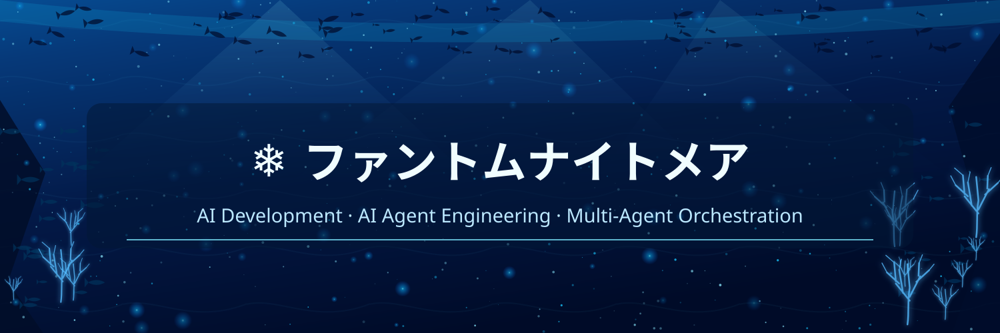

  

  

## ⚙️ DEVELOPMENT WORKFLOW

`Research` → `Design` → `Implementation` → `Debugging` → `Functional Testing` → `MSIX Packaging` → `Microsoft Store Submission`

## 🔎 DEVELOPMENT RECORDS

- [AI Agent Code Tests — AI-Integration-Test](https://github.com/Phantom-Nightmare2/AI-Integration-Test)

---

PHANTOM NIGHTMARE · APPLICATION DEVELOPMENT × AI AGENT SYSTEMS

